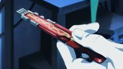

<p align="center">
  
  
</p>

Bring Capri (back lol) to life as a desktop companion! Inspired by jpartnma_'s tiktok video.

Beware that Capri may try to take over your human CPU. We take no responsibility for her actions.

To download it just click on the release in the right hand corner and click capri-setup.exe!

To compile it yourself, make sure you have the following installed: .NET 8.0 SDK and run "dotnet build app\Capri.csproj --configuration Release" in the root directory of the project. The compiled .exe will be located in app\bin\Release\net8.0-windows\win-x64\publish\.

## Optional local Whisper input

The **Use local Whisper input** option uses a local Python server to transcribe microphone input. Python is not required for the rest of Capri.

On Windows, install Python 3.10 or newer and FFmpeg. Make sure `ffmpeg.exe` is available on `PATH`, then run these commands from the repository root:

```powershell
py -3 -m venv .venv-whisper
.\.venv-whisper\Scripts\python.exe -m pip install --upgrade pip
.\.venv-whisper\Scripts\python.exe -m pip install fastapi uvicorn faster-whisper numpy python-multipart
```

Build and run Capri from the repository checkout so it can find `whisper_server.py`:

```powershell
dotnet build app\Capri.csproj --configuration Release
.\app\bin\Release\net8.0-windows\Capri.exe
```

The first time local Whisper is used, `faster-whisper` downloads the `base` speech model. The default configuration runs on the CPU using `int8`. To use a different Python executable, set `CAPRI_WHISPER_PYTHON` before starting Capri:

```powershell
$env:CAPRI_WHISPER_PYTHON = "C:\path\to\python.exe"
```

### Optional local Qwen TTS

To use the local Qwen voice-cloning model for Capri's generated replies, create the Qwen environment and install its dependencies:

```powershell
python -m venv .venv-qwen
.\.venv-qwen\Scripts\python.exe -m pip install --upgrade pip
.\.venv-qwen\Scripts\python.exe -m pip install qwen-tts torch soundfile
```

For an NVIDIA GPU, install the matching CUDA PyTorch build instead of the default CPU build. For example:

```powershell
.\.venv-qwen\Scripts\python.exe -m pip uninstall -y torch torchvision torchaudio
.\.venv-qwen\Scripts\python.exe -m pip install torch torchvision torchaudio --index-url https://download.pytorch.org/whl/cu128
```

Start Capri from the repository checkout, open the Mainframe, and enable **Use local Qwen TTS**. Capri starts `qwen_server.py` on demand, loads the `Qwen/Qwen3-TTS-12Hz-0.6B-Base` model once, prepares the reference voice once, and sends each generated reply to the local server. The synthesized WAV is played through Capri.

The default reference audio is `CapriAudio.wav` in the repository root. Set a different local reference file before starting Capri when needed:

```powershell
$env:QWEN_REFERENCE_AUDIO = "C:\path\to\reference.wav"
```

For Ollama, Capri uses a 2048-token context by default so models are more likely to remain fully on the GPU. Increase it when needed:

```powershell
$env:CAPRI_OLLAMA_CONTEXT = "4096"
```

To explicitly request an Ollama GPU layer count, set this before starting Capri. Leave it unset to let Ollama choose automatically; `999` requests all layers that fit:

```powershell
$env:CAPRI_OLLAMA_NUM_GPU = "999"
```

The default CUDA settings are `cuda:0`, `float16`, and SDPA attention. `float16` is generally faster on older NVIDIA GPUs such as the GTX 1660. Override them when needed:

```powershell
$env:QWEN_DEVICE = "cuda:0"
$env:QWEN_DTYPE = "float16"
$env:QWEN_ATTENTION = "sdpa"
```

If Capri cannot find the environment, set `$env:CAPRI_QWEN_PYTHON` to the full path of its Python executable.

Have fun and more updates to come!

Features I'd like to add:

- Tray application
- Voice lines (with mute)
- Text bubbles?
- Possibility to connect local LLM for conversations
- More animations, images &amp; quirks
- Head pats (smh)
- Mischief mode (screen glitches, stealing your cursor, "you've been hacked" notes)
- Sitting on top of your windows
- Peeking from the edge of the screen when you're idle
- Start with Windows
- Hiding while you're in fullscreen games or videos
- Alarms &amp; a study timer